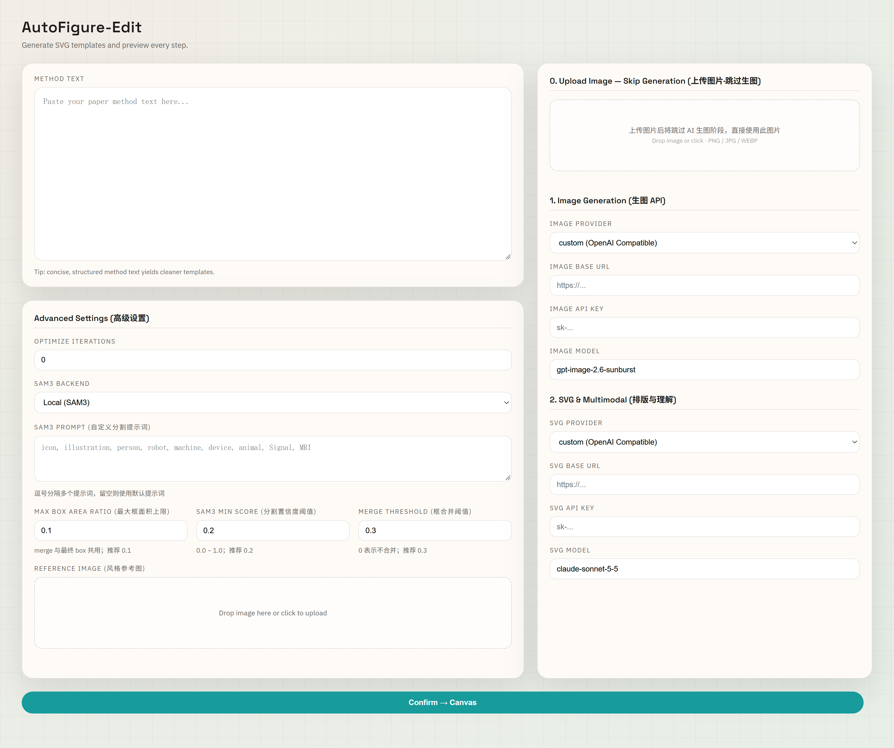

<div align="center">


# AutoFigure-Edit · Windows

**把论文里的方法段落，变成可编辑的矢量插图。**

Windows 一键启动版 · 基于 [ResearAI/AutoFigure-Edit](https://github.com/ResearAI/AutoFigure-Edit)


</div>



## 简介

AutoFigure-Edit 将 Method Text 依次经过生图、SAM3 图标检测、图标去背、多模态 SVG 重建与图标注入，最终得到一份**纯代码、可深度编辑的 SVG**。生成结果可以直接在内嵌的 SVG 编辑器中修改，也可以导出为 PowerPoint 原生的可编辑形状。

这个仓库是面向 Windows 的启动与整理版本：双击 `start.bat` 即可打开界面，并附带独立的启动器、应用图标与原生 PPTX 导出桥接。

## 特性

- **Text to Figure**：从方法段落生成论文插图底图。
- **SAM3 图标检测**：支持本地 SAM3，也支持 fal / Roboflow API。
- **可编辑 SVG**：输出由 `<rect>`、`<path>`、`<text>` 组成的矢量模板，文字与形状均可编辑。
- **内嵌编辑器**：基于 svg-edit，在浏览器里直接改图。
- **风格参考图**：上传参考图片，让生成结果贴近目标风格。
- **原生 PPTX 导出**：通过 svg2ooxml 输出 DrawingML 形状与文本框，可在 PowerPoint 中继续编辑。
- **一键启动**：`start.bat` 自动寻找 Python 环境并打开浏览器。

## 快速开始

### 1. 准备环境

```bash
conda create -n figure python=3.10 -y
conda activate figure
pip install -r requirements.txt
```

> 启动器会优先寻找名为 `figure` 的 conda 环境，也可以通过环境变量 `AUTOFIGURE_PYTHON` 指定解释器。

### 2. 启动

直接双击 `start.bat`，或手动运行：

```bash
python launch.py
```

启动器会打印本地访问地址并自动打开浏览器。

### 3. 本地模型

SAM3 与 RMBG 的权重不随仓库分发。将模型放到 `models/`（或按 `download_models.py` / 上游文档配置），本地模式即可使用。

## 默认模型

| 链路 | 默认模型 |
| :--- | :--- |
| 生图 API | `gpt-image-2.6-sunburst` |
| 多模态 / SVG | `claude-sonnet-5-5` |

两者都可以在界面右侧的 **1. Image Generation** 与 **2. SVG & Multimodal** 中修改。Provider、Base URL、API Key 均按你的网关填写。

## 原生 PPTX 导出

原生导出依赖 **Python 3.13 + svg2ooxml**（主环境通常使用 Python 3.10，所以由独立解释器完成转换）：

```bash
pip install svg2ooxml
```

如果 Python 3.13 不在默认安装位置，设置 `AUTOFIGURE_PY313` 指向对应的 `python.exe`。

## 关于 API Key

仓库不包含任何密钥或私有端点。界面中的 Provider / Base URL / API Key 默认留空，请在本地填写。

如果希望本机每次打开都自动预填，可创建 **不会被 git 跟踪** 的 `web/local-config.js`：

```js
(() => {
  const set = (id, value) => {
    const el = document.getElementById(id);
    if (el) el.value = value;
  };
  set("imageProvider", "custom");
  set("imageBaseUrl", "https://your-endpoint");
  set("imageApiKey", "sk-...");
  set("imageModel", "gpt-image-2.6-sunburst");
})();
```

该文件已加入 `.gitignore`，提交前无需再做额外处理。

## 目录结构

```text
AutoFigure-Edit/
├─ start.bat              # Windows 一键启动
├─ launch.py              # 启动器：找环境、起服务、开浏览器
├─ server.py              # FastAPI 服务与 PPTX 导出接口
├─ autofigure2.py         # 生成流水线（生图 / SAM3 / SVG）
├─ svg2pptx_bridge.py     # Python 3.13 原生 PPTX 转换桥
├─ pptx_text_merger.py    # PPTX 文本合并后处理
├─ svg_marker_expander.py # SVG marker 展开
├─ web/                   # 前端页面与内嵌编辑器
├─ models/                # 本地模型（不随仓库分发）
└─ outputs/               # 每次任务的输出
```

## 来源与许可

本项目 fork 自 [ResearAI/AutoFigure-Edit](https://github.com/ResearAI/AutoFigure-Edit)，遵循 MIT License。原始工作为 ICLR 2026 论文 *AutoFigure*；如果它对你的研究有帮助，请引用原论文并给上游仓库一个 Star。
